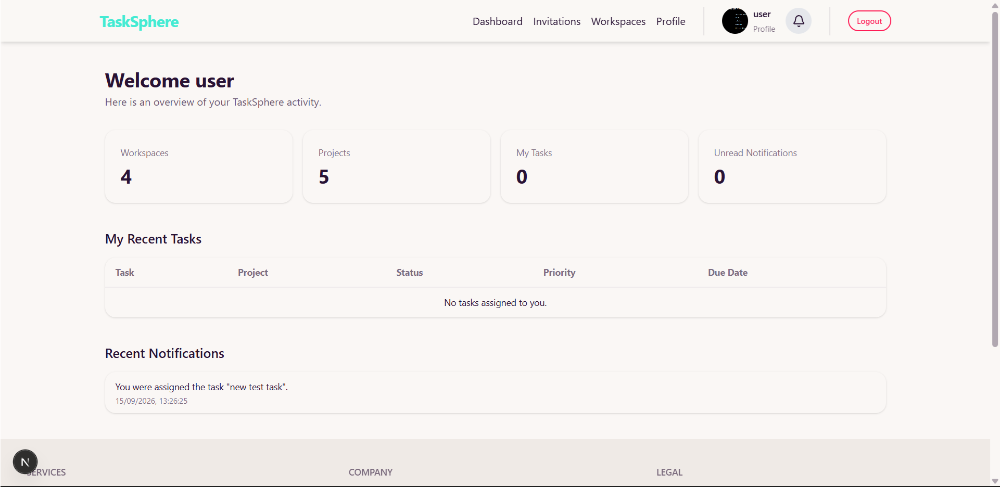
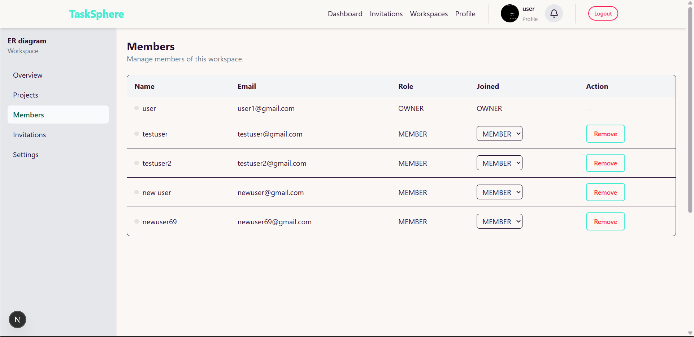
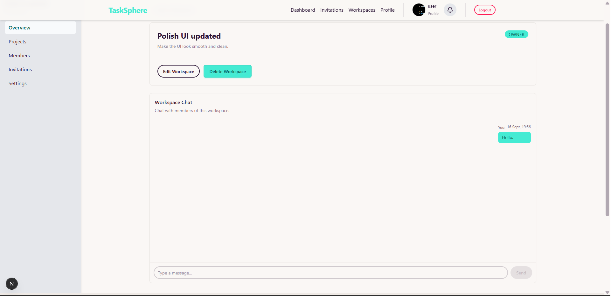
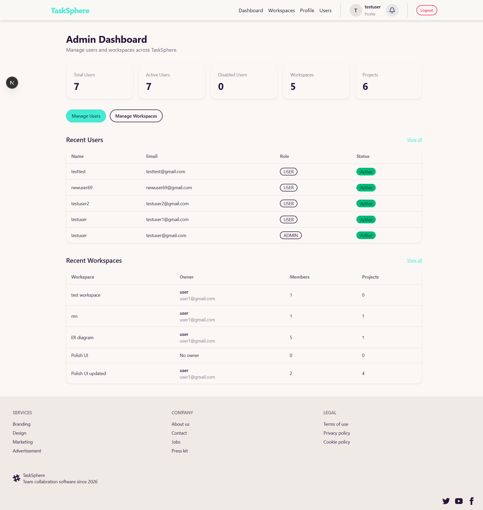
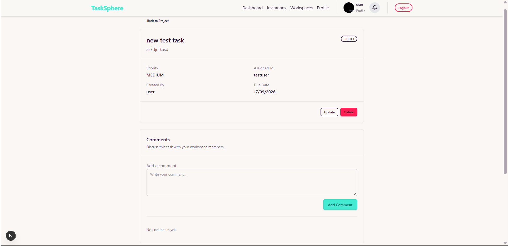
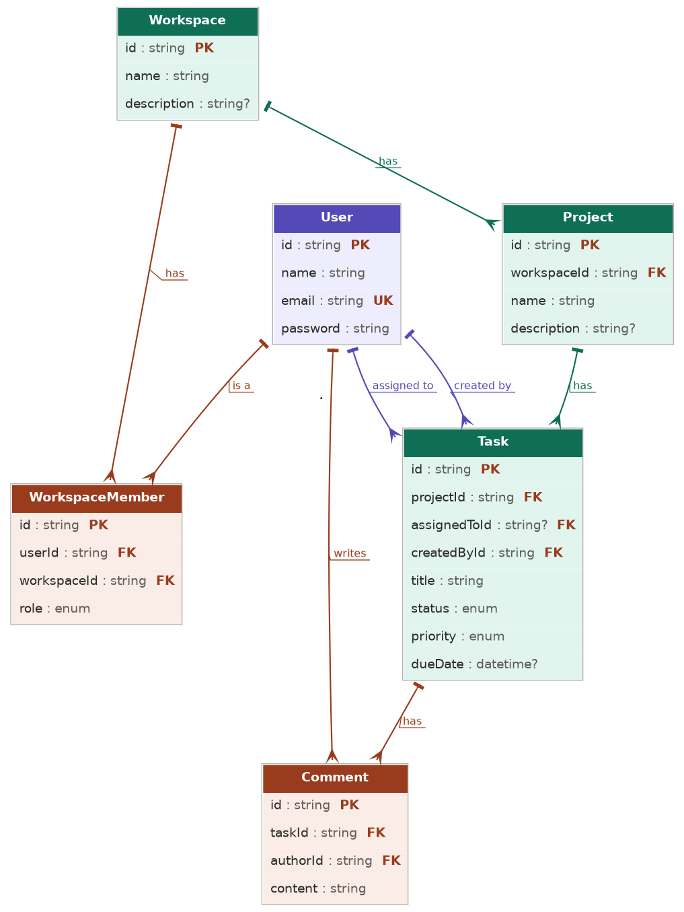

# TaskSphere

> **Where teams orbit around what matters.**

TaskSphere is a full-stack workspace, project, and task management platform — built to explore how real production apps are wired together, end to end. Think Trello meets Slack, built from scratch with a modern TypeScript stack.



---

## Why TaskSphere?

Most task apps stop at CRUD. TaskSphere goes further — real-time chat, role-based access at two levels (platform *and* workspace), and an admin control plane, all built by hand to understand what's really happening under the hood of tools like Linear, Asana, or ClickUp.

---

## Features

| Area                 | Highlights                                                                                   |
| -------------------- | -------------------------------------------------------------------------------------------- |
| **Auth**             | Auth.js sessions, bcrypt hashing, protected routes, user/admin roles, account enable/disable |
| **Workspaces**       | Owner/Admin/Member roles, invitations, member management                                     |
| **Projects & Tasks** | Full CRUD, assignees, status, priority, due dates                                            |
| **Comments**         | Threaded task discussion                                                                     |
| **Live Chat**        | Socket.IO-powered, real-time, per-workspace                                                  |
| **Admin Panel**      | Manage users & workspaces platform-wide                                                      |

**Task board**


**Real-time chat**


**Admin panel**


**Task detail & comments**


---

## Tech Stack

**Frontend** — Next.js · React · TypeScript · Tailwind CSS · TanStack Query · React Hook Form · Zod

**Backend** — Next.js API Routes · Auth.js · Prisma · PostgreSQL · bcrypt · Socket.IO

---

## Architecture at a Glance

```text
tasksphere/
├── app/            → routes, pages, API handlers
├── components/      → UI building blocks
├── hooks/            → shared React logic
├── lib/               → core utilities
├── schemas/         → Zod validation
├── services/        → data access layer
├── prisma/           → schema & migrations
└── auth.ts            → Auth.js config
```

**Two independent role systems:**
- **Platform roles** → `USER` / `ADMIN` — who can access the admin panel
- **Workspace roles** → `OWNER` / `ADMIN` / `MEMBER` — who can do what *inside* a workspace

**Database schema (ER diagram)**


---

## Quick Start

```bash
git clone <your-repository-url>
cd tasksphere
npm install
```

Create a `.env` file:

```env
DATABASE_URL="your-postgresql-database-url"
AUTH_SECRET="your-auth-secret"
NEXT_PUBLIC_SOCKET_URL="http://localhost:3001"
```

Set up the database and launch:

```bash
npx prisma migrate dev
npx prisma generate
npm run dev
```

App → `http://localhost:3000`
Socket.IO server → `http://localhost:3001` (run separately for live chat)

---

## What This Project Demonstrates

- Designing a relational schema (Users, Workspaces, Projects, Tasks, Comments, Invitations, Messages) with Prisma
- Two-tier role-based access control
- Real-time features with Socket.IO
- Type-safe forms and validation with React Hook Form + Zod
- Server state management with TanStack Query
- Building an admin dashboard from scratch

---

## Status

Actively evolving — core features (auth, workspaces, projects, tasks, comments, real-time chat, admin panel) are live, with more on the way.

---

## Author

**Sujan Neupane**